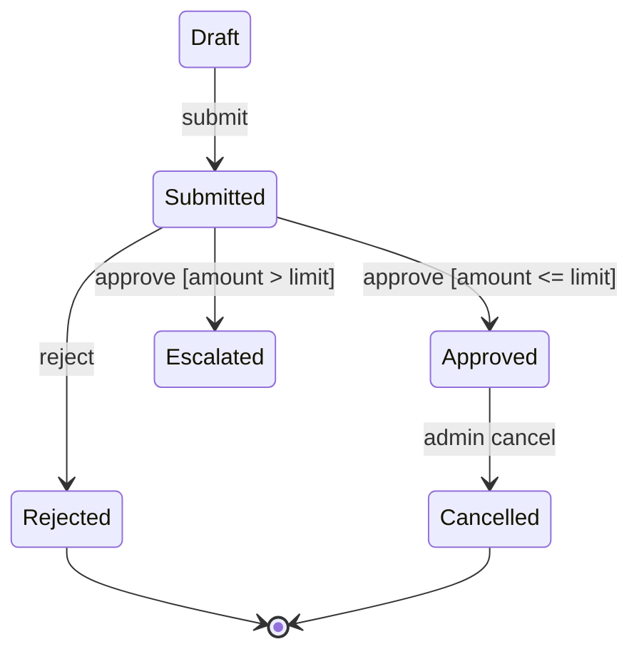

# State Model Reference

Use this reference after naming the state-bearing subject and public seam. Capture only what the current change touches; a section with nothing in scope stays out of the chart.

## What a chart answers

- **Subject and seam**: the domain object or process whose state changes, where its state lives (status field, in-memory state, queue message, provider state, event log), and the command, handler, API, job, or reducer where behavior is tested.
- **States**: each in-scope state with its domain meaning, and whether it is terminal.
- **Events and commands**: what can attempt a change. A command is intent (`submit`, `cancel`); an event is a fact that already happened (`payment_succeeded`).
- **Legal transitions**: `<Current state> + <Event> [<guard>] -> <Next state>`. A guard is the condition the transition needs (`[amount <= limit]`); when one event leads to different states under different conditions, write one line per guard and make the guards cover every case. Group states that behave the same.
- **Invalid transitions**: what an event does from a state where it is not legal: reject, ignore, idempotent no-op, queue, compensate, or escalate. Group states with the same answer instead of listing a full matrix.
- **Invariants**: facts true in every state ("a paid order always has a payment id"), with where each is enforced or tested.
- **Side effects**: attached to the transition that fires them, not to a state. When an external call is involved, say whether it runs before or after persistence and what happens if one half fails.

Duplicate, late, out-of-order, or concurrent events belong in the chart when they can reach the behavior touched by this change. When they do, name the idempotency key, ordering source, or lock that decides the outcome. When the outcome depends on many interleavings at once, that is the case for the model check in [SKILL.md](./SKILL.md).

## Formats

Use the lightest one that is clear.

### Note

For small changes.

```text
Subject / seam:
States and events in scope:
Transitions:
Invalid behavior:
Invariants:
```

### Transition table

| Current state | Event | Guard | Next state | Side effects | Invalid? |
|---|---|---|---|---|---|
| Draft | Submit | | Submitted | Notify reviewers | No |
| Submitted | Approve | amount <= limit | Approved | Publish approval event | No |
| Submitted | Approve | amount > limit | Escalated | Notify approver | No |
| Approved | Submit | | Approved | None | Idempotent no-op |
| Cancelled | Approve | | Cancelled | None | Reject |

### Mermaid state diagram

When relationships are easier to see visually.



`[*]` marks a terminal state.

### Test matrix

When preparing TDD: at least one legal transition, one invalid transition, and the terminal or duplicate behavior if the change touches it.

| Behavior | Seam | Expected result |
|---|---|---|
| Submit draft | Public workflow interface | Draft becomes Submitted |
| Approve approved item again | Public workflow interface | Idempotent no-op |
| Approve rejected item | Public workflow interface | Rejected with domain error |
